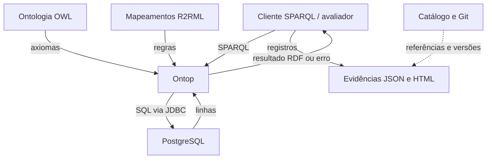

# Arquitetura do MVP

O protótipo implementa a arquitetura proposta no TCC usando dados sintéticos de pedidos de venda. As consultas são executadas com acesso somente leitura.

| Componente lógico | Implementação | Responsabilidade |
|---|---|---|
| Fonte relacional | PostgreSQL 17.11 | Clientes, produtos, pedidos e itens; integridade relacional |
| Ontologia | `ontology/vendas.ttl` | Vocabulário e hierarquia OWL, separada das convenções físicas |
| Mapeamentos | `mappings/*.ttl` | R2RML: selecionar linhas, gerar IRIs e associar propriedades |
| Mecanismo de consulta | Ontop 5.5.0 + JDBC 42.7.8 | Reformular SPARQL em SQL; inferir subclasses; consultar como `tcc_leitor` |
| Catálogo | `catalog/*.json` + metadados extraídos | Termos, sinônimos, fórmulas, relacionamentos e correspondência física |
| Rastreabilidade e avaliação | `mvp/__main__.py` + Git | Registrar tentativas, comparar resultados e preservar versões e erros |

O Protégé é um editor opcional para inspecionar `ontology/vendas.ttl`; não é necessário para executar as consultas. As versões Turtle da ontologia também podem ser abertas em editores de texto.

## Inferência e transformação

O código 2 é interpretado como `PedidoConcluido` pelo mapeamento. A ontologia declara `PedidoConcluido rdfs:subClassOf Pedido`. Não há mapeamento direto para a classe `Pedido` nem axiomas de domínio capazes de produzir esse tipo. QC08 deve retornar `true`; removendo apenas a hierarquia, o controle negativo deve retornar `false`. Ontologia não substitui as restrições SQL.

## Avaliação e comparação

As dez consultas SQL de referência são independentes das consultas SPARQL e dos mapeamentos. Seus resultados são salvos antes da alteração do esquema. Algumas questões também verificam casos específicos da base: o total de 36,53 do pedido 2 em QC04, os clientes 9 e 10 em QC06 e as duas ocorrências do produto 2 em QC10.

O contrato especifica tipos e campos. A comparação usa multiconjuntos: ignora ordem e preserva duplicidades. Decimais são exatos; SQL NULL corresponde a variável SPARQL não vinculada, apenas nos campos opcionais. Não existe coerção para zero ou texto vazio. Os identificadores retornados são propriedades inteiras; IRIs usam `https://example.org/tcc/recurso/{entidade}/{id}` e não são convertidas por heurística.

O banco `tcc_demo` serve à demonstração. A avaliação recria somente o esquema `experimento` do banco separado `tcc_avaliacao`, executa a base original, renomeia `cod_situacao` para `situacao_id`, executa com artefatos antigos e repete com mapeamento e catálogo corrigidos. Ontologia, dados e consultas permanecem iguais. O administrador prepara e altera o banco; Ontop e referências SQL usam `tcc_leitor`. O controle negativo ocorre após as 30 tentativas e é registrado separadamente.

Cada tentativa registra a questão, a configuração, o resultado ou erro, o horário, o commit e os artefatos utilizados. O manifesto reúne os hashes dos arquivos. Os metadados de cada etapa incluem colunas, tipos e restrições PK/FK. A rastreabilidade é feita por consulta e arquivo; a SQL interna gerada pelo Ontop e a origem de cada célula não são coletadas nesta versão.

## Análise da arquitetura e das definições do domínio

A análise da arquitetura considera a atribuição de responsabilidades aos seis componentes e a descrição de suas interfaces. A fonte relacional armazena os dados e suas restrições; a ontologia define o vocabulário e a hierarquia; os mapeamentos relacionam esse vocabulário às estruturas físicas; o Ontop recebe SPARQL e acessa o banco por SQL via JDBC; o catálogo reúne as definições e correspondências; o avaliador compara respostas e registra as evidências. O diagrama explicita as entradas, as saídas e o fluxo entre esses componentes. Esses elementos fundamentam o atendimento ao requisito de descrição da arquitetura.

A análise das definições do domínio considera os termos Cliente, Produto, Pedido, ItemPedido e PedidoConcluido, seus sinônimos, a relação entre pedidos, clientes e itens e a fórmula do total do pedido. O catálogo explicita a granularidade por pedido, a unidade monetária e a exclusão de frete, tributos, descontos e devoluções. A correspondência física acompanha as versões original e corrigida do esquema. O atendimento ao requisito de metadados e definições combina esse exame com a validade estrutural do catálogo.

Esses exames são distintos dos testes de funcionamento. Os critérios constam em [requirements.json](requirements.json), e o [registro de análises](analises.json) vincula as conclusões aos hashes dos arquivos examinados. A presença dos arquivos não comprova o atendimento; uma versão alterada requer nova análise. Falhas estruturais do catálogo permanecem visíveis mesmo quando a análise de suas definições está concluída.

O [relatório final](analise-final/relatorio.html) reúne essa análise e os resultados da execução documentada. No cenário sintético, os sete requisitos foram considerados atendidos. A consolidação documental preserva os registros da execução original e não representa uma nova execução das consultas.

## Limites

A avaliação usa 10 clientes, 10 produtos, 30 pedidos e 60 itens. Os resultados se limitam a esse domínio sintético, ao pequeno volume de dados e a uma única alteração de esquema. Não houve avaliação em produção. Os tempos registrados servem ao diagnóstico da execução.

O catálogo cobre as dez questões do roteiro, sem interpretação de perguntas em linguagem natural.

As credenciais do Compose são públicas e destinadas à demonstração local. O PostgreSQL não publica porta para o host, e a interface do Ontop fica vinculada ao loopback.
