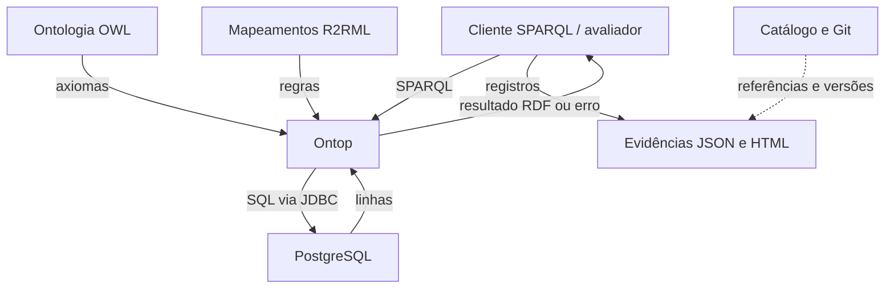

# Arquitetura do MVP

O protótipo instancia a arquitetura do TCC com dados sintéticos e consultas somente leitura.

| Componente lógico | Implementação | Responsabilidade |
|---|---|---|
| Fonte relacional | PostgreSQL 17.11 | Clientes, produtos, pedidos e itens; integridade relacional |
| Ontologia | `ontology/vendas.ttl` | Vocabulário e hierarquia OWL, separada das convenções físicas |
| Mapeamentos | `mappings/*.ttl` | R2RML: selecionar linhas, gerar IRIs e associar propriedades |
| Mecanismo de consulta | Ontop 5.5.0 + JDBC 42.7.8 | Reformular SPARQL em SQL; inferir subclasses; consultar como `tcc_leitor` |
| Catálogo | `catalog/*.json` + metadados extraídos | Termos, sinônimos, fórmulas, relacionamentos e correspondência física |
| Rastreabilidade e avaliação | `mvp/__main__.py` + Git | Registrar tentativas, comparar resultados e preservar versões e erros |

O Protégé é um editor opcional para inspecionar `ontology/vendas.ttl`; não é necessário para executar as consultas. As versões Turtle da ontologia também podem ser abertas em editores de texto.

## Inferência e transformação

O código 2 é interpretado como `PedidoConcluido` pelo mapeamento. A ontologia declara `PedidoConcluido rdfs:subClassOf Pedido`. Não há mapeamento direto para a classe `Pedido` nem axiomas de domínio capazes de produzir esse tipo. QC08 deve retornar `true`; removendo apenas a hierarquia, o controle negativo deve retornar `false`. Ontologia não substitui as restrições SQL.

## Avaliação e comparação

As dez referências SQL são escritas separadamente das consultas SPARQL e dos mapeamentos. São executadas e preservadas antes da mudança. QC04 tem uma verificação adicional independente do valor 36,53 para o pedido 2; QC06 identifica os clientes 9 e 10; QC10 exige duas linhas com produto 2. Essas verificações são automatizadas, não uma revisão humana já realizada.

O contrato especifica tipos e campos. A comparação usa multiconjuntos: ignora ordem e preserva duplicidades. Decimais são exatos; SQL NULL corresponde a variável SPARQL não vinculada, apenas nos campos opcionais. Não existe coerção para zero ou texto vazio. Os identificadores retornados são propriedades inteiras; IRIs usam `https://example.org/tcc/recurso/{entidade}/{id}` e não são convertidas por heurística.

O banco `tcc_demo` serve à demonstração. A avaliação recria somente o esquema `experimento` do banco separado `tcc_avaliacao`, executa a base original, renomeia `cod_situacao` para `situacao_id`, executa com artefatos antigos e repete com mapeamento e catálogo corrigidos. Ontologia, dados e consultas permanecem iguais. O administrador prepara e altera o banco; Ontop e referências SQL usam `tcc_leitor`. O controle negativo ocorre após as 30 tentativas e é registrado separadamente.

Os registros incluem o commit, os artefatos e seus hashes, versões, horário, questão, requisitos, configurações, resultados ou erros. Os metadados de cada etapa incluem colunas, tipos e restrições PK/FK. A SQL interna gerada pelo Ontop não é coletada nesta versão; as SQL em `queries/sql` são referências independentes. Não se afirma proveniência individual de cada célula.

## Limites

Um domínio sintético com 10 clientes, 10 produtos, 30 pedidos e 60 itens não sustenta conclusões sobre escala ou uso empresarial. Tempos são diagnósticos, não benchmark. A revisão humana das definições é registrada como pendente. O catálogo documenta o roteiro e não faz interpretação automática de linguagem natural. As credenciais do Compose são públicas e destinadas exclusivamente à demonstração local; PostgreSQL não publica porta, e a interface é vinculada ao loopback.
